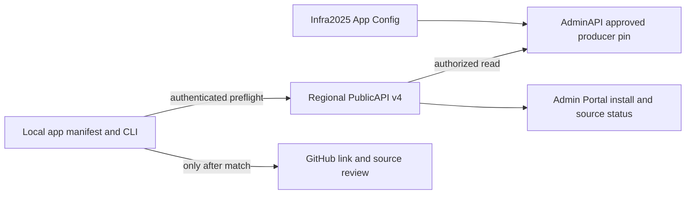
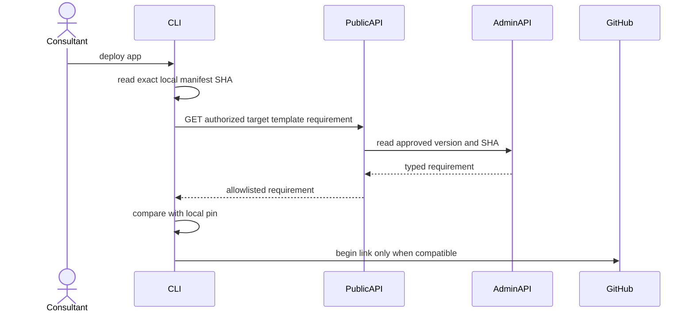

# Plan: Explain and prevent unsupported app-template deploys

- **Engineer:** Van with Codex (draft for stakeholder review)
- **Primary repo:** `eai-support/eai`
- **Issue:** `enterpriseaigroup/Issues2025#3574`
- **Status:** draft

## 1. Why — business outcome

A consultant using CLI 3.18.4 scaffolded app template v1.0.7 and completed GitHub linking before `deploy app` returned an opaque 409. DEV accepts v1.0.17. The customer must know the mismatch and a safe recovery path *before* OAuth. Success: a controlled test with the old project gives a current/required template message before link creation; old CLIs still receive a stable, safe 409 explanation; the Deploy page does not imply an operation exists when none does.

## 2. Customer journey

Today: sign up → create app → scaffold with an old CLI → start deploy → complete GitHub OAuth → receive generic 409 → find no actionable Portal state. Proposed: sign up → create app → run deploy → local/remote template compatibility check → either continue to GitHub with the same source bundle or stop with exact current/required versions and a supported project-upgrade guide. The mismatch path removes the OAuth step and its return visit (at least two customer actions); the compatible path adds no click. No new app or source operation is created on a mismatch.

## 3. Ecosystem scan

The workspace ecosystem discovery listed the `enterpriseaigroup`, `eai-support`, `EAI-Website`, `EAI-verticals`, `eai-connectors`, and `eai-generated-apps` organizations. The issue, open PR lists, and local source in CLI, AdminAPI, PublicAPI, Admin-Portal, Infra2025, and `eai-testing-dev` were checked on 2026-10-15. Reuse CLI `.eai-manifest.json` reading and `eai template check`, AdminAPI's approved SHA setting and actor-bound preparation, PublicAPI's v4 management proxy and safe error envelope, Portal's existing source status panel and CLI install card, and Infra2025's template version/SHA values. AdminAPI's active #3503 branches, PublicAPI #1109/#1111, and Portal #706 are unrelated in-flight work and must not be overwritten. Draft Portal #708 separately repairs the empty UI state without changing a contract. No existing customer-facing migration command was found. A repo-wide search found template migration commit trailers and validation in CLI, but not a documented procedure.

## 4. Blast radius

Change kinds: v4 HTTP read contract and error envelope, CLI command behavior, App Configuration/version metadata, Portal UI copy, and release drift check. Affected owners: CLI, AdminAPI, PublicAPI, Admin-Portal, Infra2025, `eai-testing-dev`, and customer documentation. AdminAPI must continue accepting exact replays of older operations; only *new* source admission uses the current pin. PublicAPI must expose only an allowlisted code/version/SHA, never a raw AdminAPI response. CLI and Portal consume that typed contract. The workspace scan found these consumers; no other importers found is not proof of containment, so the final diff requires a fresh blast-radius walk.

## 5. Multi-tenancy

1. Reuse the existing authenticated JWT and app-scope tenant propagation; the read must bind the caller to the requested tenant/app.
2. Compatibility metadata comes from deployment configuration, not a cross-tenant database query. Any enrollment lookup remains tenant-scoped.
3. Use the existing v4 generated-source authorization/OPA route family; do not bypass it or broaden roles for a convenient preflight.
4. No queue or event is added, so no new tenant tag is needed.
5. No role-hierarchy change: a caller who cannot prepare source must not gain app-specific compatibility details.
6. CLI calls the regional PublicAPI for the target app; it never contacts AdminAPI or Configurator directly. New route/authorization mapping needs an `opa-auth-review` before code.

## 6. Multi-region

The CLI reads the same region/environment pin that would judge the later preparation; do not infer it from a local package version or another region's App Config. `homeRegion` remains the platform's region code (for example `au`), not Azure `ae`. Configurator stays in the AU control plane and is accessed through the regional PublicAPI path already used by the app. DEV, TEST, PROD, and each active region need an exact version/SHA pair and drift evidence. A pin change between preflight and preparation still fails safely at admission with the new typed error.

## 7. Architecture

## 8. Flows

### Happy path

### Failure paths

- Unauthenticated or wrong-tenant callers receive the existing 401/403/404 behavior without disclosing another app or tenant.
- An older local template receives a stable `TEMPLATE_VERSION_NOT_APPROVED` code, current and required identifiers, and the upgrade guide before OAuth. The backend keeps this code for old CLIs reaching preparation.
- Timeout/5xx or malformed requirement fails closed before GitHub; the CLI names the temporary preflight failure without claiming a version mismatch.
- If configuration changes between preflight and preparation, admission returns the new requirement in the same client-safe envelope; no operation or repository is created.
- Exact operation replay/recovery retains its original pin and is not blocked by a newly approved template.

## 9. UI/UX

Use existing Portal components and copy styles. On Overview/Getting started, show an environment-derived minimum CLI/template pair adjacent to `npm install -g eai-cli`; loading/unavailable states do not guess a version. On Deploy, show a truthful empty state until an operation exists (Portal #708), then pending/review/failed/completed states from actual operation status. Errors name the next action and preserve a refresh path. Keep text keyboard-readable and avoid a new modal or UI library. The existing Portal is Tailwind v4; no new responsive layout variant is needed.

## 10. Performance, scalability, responsiveness

One small read before an interactive GitHub link, target p95 under 500 ms excluding network; bounded response (version, SHA, code only), no repository scan or build. A brief cache is acceptable only if the authoritative preparation rechecks the pin. At 10x deploy starts, App Config/proxy latency and rate limits matter before payload size. Avoid an unbounded release lookup per request.

## 11. Infra and config

Infra2025 already carries template SHA and version values, but AdminAPI currently reads only the SHA. Add an explicitly paired version setting only if the approved design cannot derive it safely from an immutable release manifest. No new resource or secret. Check all environment/region App Config labels and the release drift guard; do not silently promote a config value. Existing operations remain pinned. Exact PROD rollout is separate from merging this code.

## 12. Options and reasoning

### Option A — Authenticated server requirement before OAuth

Reuses the server's actual admission pin, prevents a needless GitHub step, and leaves preparation authoritative. Cost: coordinated read route, safe error mapping, config pair and tests. Risk: a stale preflight result, handled by the final preparation check.

### Option B — CLI package-version table and local warning only

Cheaper and works offline. It can be stale across environments/regions and cannot explain a dynamic platform pin to old CLIs, so it cannot satisfy the issue's acceptance criteria.

### Decision

Propose A. The CLI package should give the documented upgrade command but never declare an environment compatible solely from its bundled version. Open question for stakeholders: whether to ship a guarded `template migrate` command or a reviewed, documented migration procedure in the MVP. The existing manifest-only trailer validation is insufficient evidence that application files were actually reviewed.

## 13. Test and release evidence

CLI: old/new/missing manifest, before-link ordering, timeout, malformed/stale response, exact replay, and message tests. AdminAPI: mismatch code and safe requirement, auth/tenant denial, no operation mutation, exact replay exception. PublicAPI: typed allowlist, code/version forwarding, raw-body redaction, unauthorized denial. Portal: install version loading/error/ready and empty/pending source labels. Infra2025: every environment/region version/SHA pair and packaged CLI pin drift check. Update each owner `.eai/test-coverage.json`; add a small `eai-testing-dev` v4 auth/contract smoke and config drift assertion, not a broad live customer journey. CI/merge evidence is separate from an authenticated customer test.

## 14. MVP negotiation (80:20)

### In MVP

**Proposed, not approved:** authorized requirement preflight before GitHub; safe stable fallback 409 for old CLIs; truthful Portal empty state and minimum version; documented, reviewed migration path that does not silently rewrite source; config-pair drift guard; focused owner and deployed-contract tests.

### Deferred

**Proposed:** automated file migration/rebase if manual reviewed migration proves sufficient. A new migration command must preserve source provenance and cannot merely change the manifest pin.

### Cut

**Proposed:** no auto-merge of customer source and no force-deploy override for an unapproved template.

### Decision log

- 2026-10-15 — Codex prepared a draft from issue #3574 and source inspection; Product and CEO have not yet negotiated or approved the MVP.

### Approvals

- Product: OPEN QUESTION: named approver and date
- CEO: OPEN QUESTION: named approver and date
