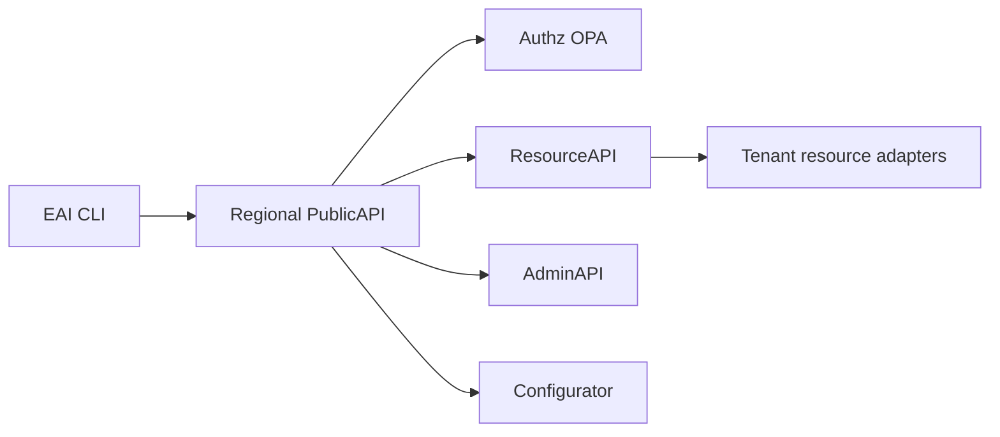
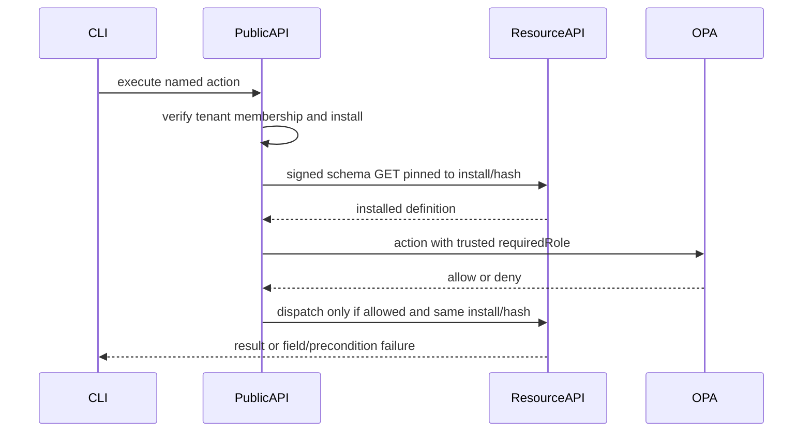

# Plan: issue 3625 CLI and data repairs

- **Engineer:** issue assignee, with Codex
- **Primary repo:** eai-support/eai
- **Issue:** enterpriseaigroup/Issues2025#3625; only #3652, #3635, #3663, #3657, #3655, #3641, #3670, #3667, #3646, #3642
- **Status:** implementation authorized by the user on 2026-11-11

## 1. Why — business outcome

App builders and workspace administrators must be able to prepare data models, maintain valid records, execute governed actions, and administer workspaces with accurate CLI results. Success means regression coverage and a demonstrated working equivalent of each of the ten reported failures. This is repair of the listed behaviors, not a Portal or publishing redesign.

## 2. Customer journey

Create or reuse an app, run the exact provision command for its owner/runtime binding, seed the model, then create/read/update records and execute actions. A failed prerequisite or schema sync must never look successful. Workspace administration must also work before an app folder exists. These are command-line journeys; click counts do not apply.

## 3. Ecosystem scan

Read all ten issues and the related #3672 dependency. Scanned 94 accessible repository entries across enterpriseaigroup, EAI-Website, eai-support, EAI-verticals, eai-connectors and eai-generated-apps. Inspected CLI, PublicAPI, ResourceAPI, Authz, AdminAPI, Configurator, template and platform documentation. The reporter's private app and uncommitted local repair are unavailable. Reuse existing executeAction/getSchema clients, TypeScript dependency, workspace context resolution, enrollment binding checks, passive schema operations and routed resource adapters. Current main was refreshed before isolated worktrees were created.

## 4. Blast radius

Changes involve CLI commands and output, tenant resolution, authorization wiring, and Object Type metadata. CLI owns authoring, guidance and presentation; PublicAPI owns trusted action authorization; Authz retains its role rules; AdminAPI and Configurator preserve the new relationship target through manifest publication; ResourceAPI validates declared references. Template changes only expose authoring metadata and guidance. Existing SDK serialization requires preservation tests rather than a new route or blanket updates to generated app SDK copies.

## 5. Multi-tenancy

1. Preserve the authenticated profile and verified membership when resolving an explicit or selected workspace.
2. Every reference lookup uses the exact tenant and target type through its canonical adapter.
3. Keep default denial and OPA role thresholds; never derive an action role from caller input.
4. No new queue message or consumer is introduced.
5. Existing role hierarchy remains unchanged; missing action roles do not default to viewer.
6. Backend control-plane calls continue through regional PublicAPI. ResourceAPI does not gain Payload or sibling-service access.

## 6. Multi-region

Use the selected profile's regional PublicAPI and the existing install resolver. Keep tenant and install/schema-hash context fixed across action authorization and dispatch. Region values use existing canonical region codes; no region or production configuration changes are planned.

## 7. Architecture

PublicAPI obtains action roles from the installed schema through an internal signed GET, caches metadata by tenant/install/schema hash, and supplies requiredRole to OPA. Resource dispatch uses the same authority. Schema mismatch must not automatically replay an already authorized action under a different schema.

## 8. Flows

### Happy path

### Failure paths

Unauthenticated and wrong-workspace requests remain denied. Missing prerequisites, invalid roles/definitions, upstream timeouts, schema drift and partial seed failures return unsuccessful status with actionable safe output and no false success. Invalid records or actions do not mutate record/version/history. Dry-run performs reads only. Preserve existing batch per-item failure semantics.

## 9. UI/UX

CLI text names failed fields/rules and recovery commands. HTTP failures from `resources create`, `resources update` and `resources action` emit one JSON stdout envelope with pinned keys and additive safe diagnostics. Keep the shared global stderr error contract. Workspace info reports available metadata honestly. Creation wording distinguishes local scaffolding from server enrollment reuse. No browser UI changes.

## 10. Performance, scalability, responsiveness

Reuse bounded HTTP timeouts and metadata-cache limits. Schema role projections are cached by tenant/install/hash, never by a guessed global slug or cached authorization result. Deduplicate reference reads within a write/batch. Do not scan every type or tenant to discover a UUID. At greater scale, adapter round trips are the primary added cost; retain batching and existing concurrency controls.

## 11. Infra and config

N/A — no new infrastructure, secrets, roles, App Config keys or deployment settings are needed.

## 12. Options and reasoning

### Option A — change update semantics and require an immediate legacy migration

Partial updates would be convenient but change existing replacement behavior. Blocking on every historical relationship definition broadens the release into a platform-wide data migration.

### Option B — preserve replacement and introduce explicit relationship targets compatibly

Keep update as full replacement with clear guidance. Add properties[].targetObjectType, require it for new/republished relationship definitions, and report legacy omissions for deliberate migration. Validate declared targets in every resource write surface.

### Decision

The user selected Option B for both decisions during planning, then explicitly requested implementation of the full proposed plan. No target inference, automatic record repair, deletion/cascade policy change, or unrelated issue work is included.

## 13. Test and release evidence

The owning repository carries its regression tests and coverage map in the same PR:

| Issue | Result to prove | Regression ownership |
| --- | --- | --- |
| #3652 | Trusted action role, tenant isolation and unchanged schema between authorization and dispatch | PublicAPI action authorization tests; Authz role policy tests |
| #3635 | Read-only preflight; exact owner/runtime binding; failed or stale schema never reports convergence | CLI type-seed preflight and types tests; AdminAPI provisioning guard tests |
| #3663 | TypeScript imports, annotations, assertions and source diagnostics load correctly | CLI Object Type loader tests |
| #3657 | Field/rule/options in create/update/action errors; full replacement documented | CLI resources command tests; ResourceAPI schema validator tests |
| #3655 | Declared target is valid in the same tenant on every write surface; invalid writes leave data/version/history unchanged | ResourceAPI unit and PostgreSQL integration tests; AdminAPI manifest tests; Configurator publication/snapshot tests; template generator tests |
| #3641 | Workspace administration works outside an app folder with the correct profile and explicit/selected workspace | CLI user/classifier/whoami tests |
| #3670 | Enrollment owner and exact runtime authorization workspace are distinguished | CLI app authorization tests |
| #3667 | Server creation and enrollment reuse have distinct receipts | CLI init tests |
| #3646 | Discover and execute actions with safe params and normal failure handling | CLI types/resources tests |
| #3642 | Workspace info and CU capabilities use the selected workspace and honor overrides | CLI workspace/CU tests |

Run the CLI build, full tests and `ci/eai-cli-tests` sequentially. Check lint/type safety, generated help/error/docs assets, all executable CLI entries in smoke traceability, and exact prepared package contents. Verify schema identity or canonical definition content when qualifying an update; the presence of an already-installed slug is insufficient.

Backend qualification uses owning native suites and disposable local data stores. Compare any broad-suite failures against unchanged `main` before attributing them to this work. Stable deployed surfaces remain `eai-cli` and `backend`.

Release the coordinated API/schema support through the normal reviewed environment flow before adopting the template and publishing CLI 3.20.13. Existing legacy relationship definitions require an explicit target before republishing, without automatic record repair. Controlled TEST journey validation and cleanup remain release evidence; local tests and prepared archives do not prove deployment. This implementation does not deploy services, publish npm, create release tags, or mutate PROD/TEST data.

### Qualification recorded on 2026-11-11

| Owner | Evidence |
| --- | --- |
| CLI | Full suite: 5,078 passed, 4 skipped, 90 files. Required `test:eai-cli:ci`: 5,000 passed, 3 skipped, 81 files, plus its docs-site checks. Build, typecheck and source lint passed. |
| PublicAPI | Native unit selection: 13,910 passed, 1 skipped. Security/OPA/V4 contract selection: 1,436 passed. After formatting, 175 action/proxy tests passed; repository Ruff lint and formatting passed. |
| ResourceAPI | Full unit suite: 3,131 passed, 22 skipped. After formatting, 45 relationship/schema tests passed. Native integration: 820 passed, 15 skipped, 1 baseline-proven missing-PostGIS fixture failure. With local fixture dependencies supplied, the dedicated storage case and all 11 signed-scope receivers passed separately; four intentional provider/performance opt-ins remain. Both new real-PostgreSQL regressions passed inside the full run. |
| AdminAPI | Full suite: 6,286 passed and 7 subtests passed. After test formatting, 301 storage/manifest tests passed. |
| Configurator | Full native Jest unit selection: 4,979 passed, 1 skipped, 378 suites. Object Type/publication/hydration selection: 42 passed. Default-value fixtures now declare valid targets and retain their existing assertions. Typecheck and focused ESLint passed. |
| Authz | All 1,089 OPA tests and policy/schema checks passed; role rules are unchanged. |
| App template | All 3 generator tests passed; native template CI also passed its validation, portability/build/health and CodeQL checks. |

The CLI candidate contains the runtime from source commit `2e5c7add990d872817b7663fcb23fd94e63ae423`. The prepared 3.20.13 archive matches all 911 packaged runtime files; SHA-1 is `7577def627924debc0a696897e0117504c705449`. Historical archives remain intact. Generated help, error guidance, documentation assets and smoke traceability are checked; traceability covers all 128 executable CLI entries, with 52 planned live rows rather than a claim of live execution.

Additional baseline comparisons were retained without changing unrelated features: combined PublicAPI unit+security collection has the same nine order-dependent failures on unchanged main and this branch, while native unit CI passes; Configurator's local security selection has the same two Civica forwarded-header assertion failures on unchanged main and this branch. These are not new feature failures.

Before enabling the relationship contract in an environment, audit parent schemas that will be inherited into newly created children. Existing child rows and unchanged legacy edits remain compatible, but a newly materialized child schema is a new definition and needs explicit targets. Built-in platform/starter/Gofer/attachment Object Type seeds currently contain no scalar relationship properties requiring backfill. No targets are inferred from names or links.

## 14. MVP negotiation (80:20)

### In MVP

All ten CLI/data issues, including minimal coordinated metadata/authorization changes and their tests.

### Deferred

Migration of unrelated legacy relationship definitions and existing dangling records; production rollout until normal release qualification.

### Cut

Partial-update/merge feature, relationship deletion/cascade redesign, and other sections of #3625.

### Decision log

2026-11-11 — User retained full-record replacement and chose compatible relationship-target rollout.

2026-11-11 — User explicitly instructed: Implement the plan. This is the session authorization for implementation; no stakeholder identity or separate signoff is invented.

### Approvals

- Product: not independently attested in this session.
- CEO: not independently attested in this session.
- Implementation authorization: user instruction, 2026-11-11; user authorization takes precedence over local workflow guidance.
